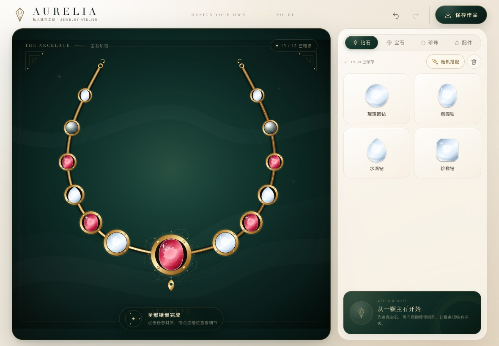

# Aurelia · 高级珠宝工坊

一个为 iPad 触屏设计的网页端珠宝定制游戏。你从一条空白的金质项链框架开始，挑选钻石、宝石、珍珠与金属配件，逐一填满 13 个镶嵌位，最后把成品装裱并保存下来。



## 已实现

- **点选式镶嵌**：先在底部/侧边材质库点选一件材质，再点击项链上的任意镶嵌位放置。选中材质后可连续镶嵌。
- **4 类 18 种材质**：钻石、彩色宝石、珍珠、金色配件，全部由手绘矢量 SVG 构成，任意放大不失真。
- **槽位管理**：点击已镶嵌的槽位可查看材质信息、单独取下；支持撤销、重做、清空。
- **随机搭配**：内置「星河流光」「红宝之夜」「皇家蓝调」「翡翠森林」「紫雾花园」「珍珠晨曦」「黑领结」7 套策展配色，随机生成左右对称的完整作品。
- **自动保存**：作品自动写入浏览器 `localStorage`，刷新或关闭页面后可继续编辑。
- **作品导出**：生成 1800×1640 的 PNG 作品图，可下载；在 iPad Safari 上也可以长按预览图直接存入相册，或通过系统分享面板分享。
- **iPad 优先布局**：横屏时材质库在右侧，竖屏时在底部；适配安全区和触控尺寸。
- **PWA 入口**：包含 manifest 与图标，可添加到 iPad 主屏幕全屏游玩。

## 本地运行

需要 Node.js 20.19+ 或 22.12+（推荐 Node.js 22 LTS 以上）。

```bash
npm install
npm run dev
```

电脑浏览器打开终端里显示的地址即可。要用 iPad 玩，让 iPad 与电脑连接同一个 Wi-Fi，然后在 iPad Safari 打开终端显示的 `Network` 地址，例如：

```text
http://192.168.1.12:5173
```

生产构建与预览：

```bash
npm run build
npm run preview
```

`vite.config.ts` 设置了 `base: './'`，所以 `dist/` 可以直接部署在任意静态站点或子路径下（Vercel、Netlify、GitHub Pages、Nginx 等）。PWA 的「添加到主屏幕」功能在 HTTPS 环境下生效；本地局域网调试时也可以先在 iPad Safari 里直接游玩。

## 测试

```bash
npm test
```

当前包含 13 个单元测试，覆盖随机搭配的完整性与对称性、设计数据的校验清洗、撤销/重做历史以及本地存储的读写与容错。

## 操作说明

1. 点击下方「钻石 / 宝石 / 珍珠 / 配件」切换材质分类。
2. 点选一件材质，材质卡会亮起金边，项链上方会出现当前材质提示。
3. 点击项链上的镶嵌位放置；保持选中状态可以连续填充。
4. 不选材质时点击已填槽位，可以查看当前材质并「取下」。
5. 使用右上角按钮撤销、重做或导出作品；「随机搭配」可以一键生成完整方案，「垃圾桶」清空当前作品。

## 项目结构

```text
src/
  App.tsx                    页面状态、交互编排、快捷键、自动保存
  components/
    Stage.tsx                项链舞台与画布上的操作提示
    MaterialTray.tsx         材质分类、材质卡、随机搭配与清空
    ExportDialog.tsx         PNG 预览、下载、系统分享
    art/
      NecklaceArtwork.tsx    项链框架、槽位、主石光环与交互态
      GemArt.tsx             所有宝石/珍珠/配件的矢量绘制
      StageBackdrop.tsx      深绿丝绒画布、品牌与装饰
  game/
    necklace.ts              13 个槽位坐标、链身曲线
    materials.ts             材质数据与分类
    themes.ts                7 套随机搭配主题
    random.ts                对称随机生成与设计数据清洗
    storage.ts               localStorage 自动保存
    exportImage.ts           SVG → PNG、下载与分享
  state/
    history.ts               纯函数撤销/重做历史
    useDesignHistory.ts      历史 Hook
```

## 如何继续定制

- **调整项链形状 / 槽位**：修改 `src/game/necklace.ts` 中的 `NECKLACE_SLOTS`。每个槽位包含 `x`、`y`、`radius`、`tier` 和 `side`；链身会自动穿过所有槽位生成平滑曲线。
- **增加材质**：在 `src/game/materials.ts` 中添加条目，并从 `MaterialShape` 中选择一种形状；新增形状时在 `src/components/art/GemArt.tsx` 中补充对应的剪裁路径和绘制细节。
- **增加随机主题**：在 `src/game/themes.ts` 中按「外圈 → 内圈」顺序添加 6 组候选材质和 1 组主石候选。随机生成会自动应用到左右对称的槽位。
- **更换品牌文案**：品牌名在 `src/App.tsx`、`src/components/art/StageBackdrop.tsx` 和 `public/manifest.webmanifest` 中调整。
- **换成位图底图**：当前框架完全由 SVG 绘制。若之后要用真实珠宝底图，把图片放到 `public/`，在 `NecklaceArtwork.tsx` 中用 `<image>` 替换链身绘制，同时保留数据化的槽位坐标即可。

## 兼容性

面向 iPadOS Safari 16+ 与现代 Chrome/Safari 设计。数据只保存在当前浏览器，没有账号系统或跨设备同步。
